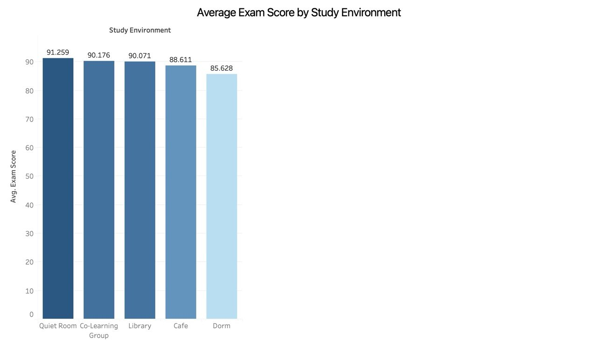
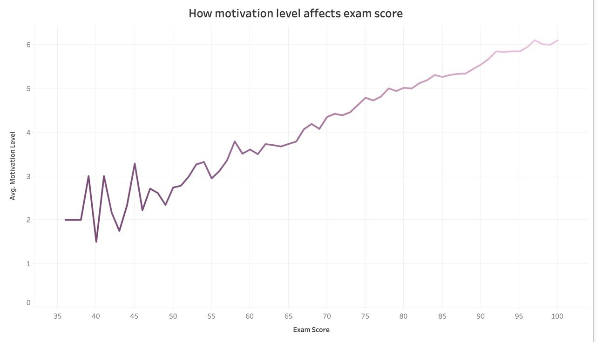
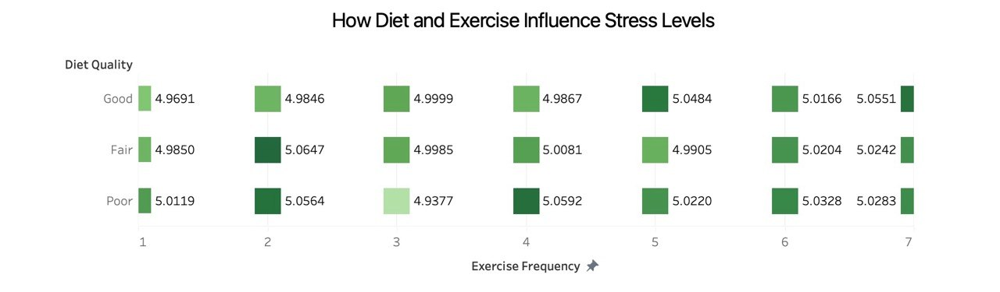
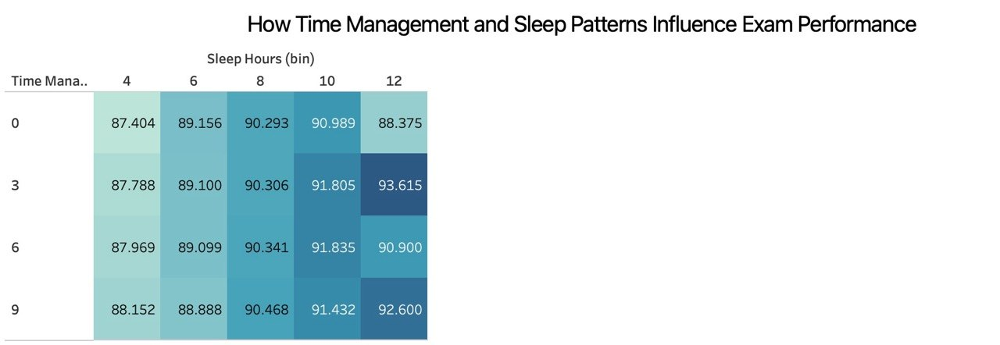

# Enhanced Student Habits Performance Dashboard

An interactive Tableau dashboard exploring how study habits, lifestyle, and motivation relate to students' exam performance.

> Group project for the Data Visualization course, Data Science Department, Umm Al-Qura University.

## Research Question
What factors are most associated with exam performance and student well-being?

## Dataset
- Each row represents one student.
- **Quantitative:** Exam Score, Stress Level, Motivation Level, Exercise Frequency, Sleep Hours
- **Categorical:** Study Environment, Gender, Diet Quality, Learning Style
- **Ordinal:** Time Management Score (0-10), Diet Quality (Poor / Fair / Good)
- **Preprocessing:** checked for missing values and consistency (no missing values found); Sleep Hours grouped into bins (4, 6, 8, 10, 12).

## Visualizations

| # | Chart | Question | Task |
|---|-------|----------|------|
| 1 | Line chart | Does higher motivation go with higher exam scores? | Correlation |
| 2 | Bar chart | Which study environment has the highest average score? | Comparison |
| 3 | Heatmap | How do diet quality and exercise frequency relate to stress? | Multivariate comparison |
| 4 | Highlight table | How do sleep and time management relate to exam scores? | Relationship discovery |

## Key Findings
- **Motivation:** average motivation rises steadily with exam score (a strong positive association).
- **Study environment:** Quiet Room (91.3) scores highest and Dorm (85.6) lowest.
- **Diet and exercise vs. stress:** average stress is almost identical across all groups (about 4.94 to 5.06), so no clear effect was found.
- **Sleep and time management:** average scores increase with sleep hours; time management shows a much weaker pattern.

> These are associations in the data, not proof of cause and effect.

## Preview

## How to Open
1. Download `Student_Habits_Dashboard.twbx` from this repo.
2. Open it with Tableau Desktop or Tableau Public.

## Tools Used
Tableau, Data Visualization, Dashboard Design, Data Analysis

## Team
- Ajwan Aqeel Turki
- Fay Salman Alzahrany
- Lina Mohammed Alhmedi
- Ghala Salem Alsabali
